# Integral Clock
### A WiFi-capable alarm clock that can play "music" and annoy you with math until you wake up.
This project's aim is to create an alarm clock capable of playing basic music, linking to other sensors over wifi, and throwing math problems at the target subject until they have no choice but to wake up. 

The current implementation features a 2.8" TFT display with 3 buttons for input (selecting answers, setting alarm, etc.) and a 420 mAh LiPo battery for travel purposes enclosed in a durable PETG casing. The only way to turn off the alarm planned right now is to be solving definite integrals. Future plans include connectivity to other modules over WiFi to require the person being subjected to this to leave the room (or maybe the house, on a morning run or similar activities) or perform other activities to ensure that they are in fact, awake, and will not return to bed.

NOTE FOR REVIEWERS: I am using a mix of parts with some that are not in the kit of parts from BLARE that I already own or intend to purchase myself. Sourcing for all parts is denoted in the BOM below and in the .csv file.

### Origin:

To be honest, I struggle with getting out of bed when my alarm goes off. I typically hit snooze at least once (or thrice) before getting out of bed as late as possible. Moving my alarm to other rooms really isn't an option and I have demonstrated that I am capable of crossing the room, digging through drawers, turning off my alarm, and going back to bed. Thus, in perhaps an overengineered fashion I decided to make my own alarm clock without a snooze function (or an off button).

I have yet to test the most effective method of inducing body temperature rise (and thus waking up) but science seems to suggest that exercise and cold showers immediately after waking up are some of the best options. Given that I have no desire to make the only method of turning off my alarm to take a cold shower in the morning, and I currently don't have a method of verifying exercising over WiFi (I may link the ESP32S3 to a watch over bluetooth or add a beam break at the door), my current plan is to use force mental exertation in order to wake my brain up (i.e. math problems). (Although, I may train a model like YOLO-8 to recognize jump roping and simply use an outdoor camera to verify physical activity, again, could be dangerous during the winter months though) 

Of course, the difficulty of the math problems have to be carefully chosen such as to be challenging enough that I can't perform them and then return to sleep (i.e. basic multiplication, simple algebra, basic derivatives, etc.) but also reasonable to complete in, say, 3 minutes after just waking up. Of course, proofs are also unable to be used because of a lack of processing power and sufficient input methods on the alarm clock. Currently I'm planning on using definite integrals to force myself to go through multiple steps per problem (while also not being too difficult, likely won't do anything past inverse trig equations) and also to force myself to use paper and pencil. This of course has the added benefit of keeping me in practice with regards to single-variable calculus.

## Wiring Schematic

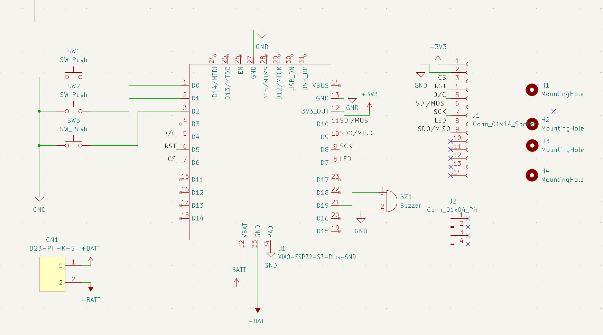

## PCB
### Top Layer:
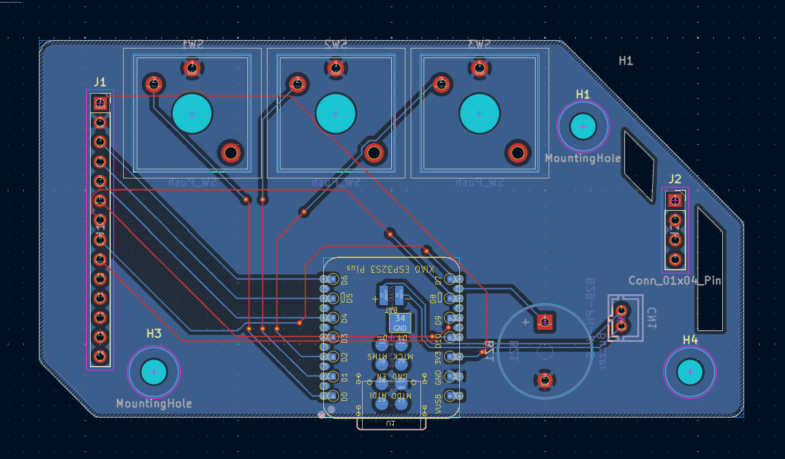

### Bottom Layer:
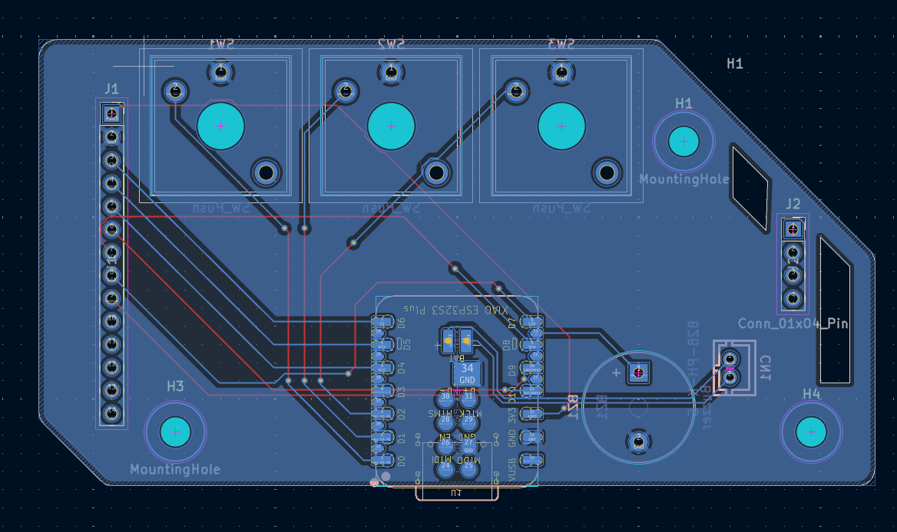

### 3D View Top:
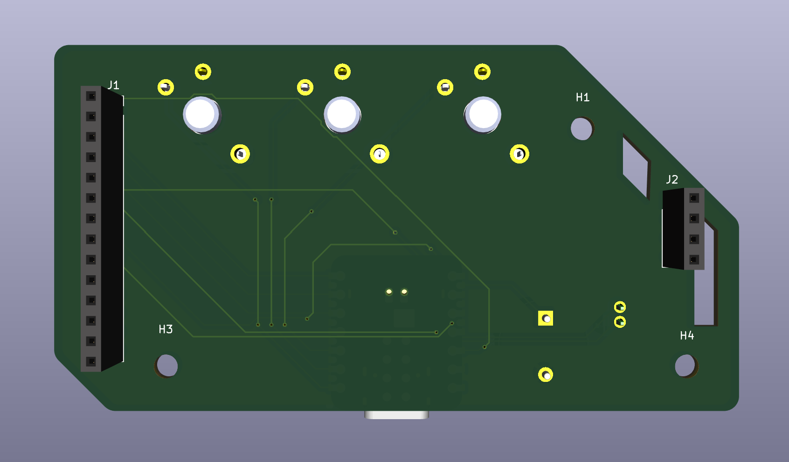

### 3D View Bottom:
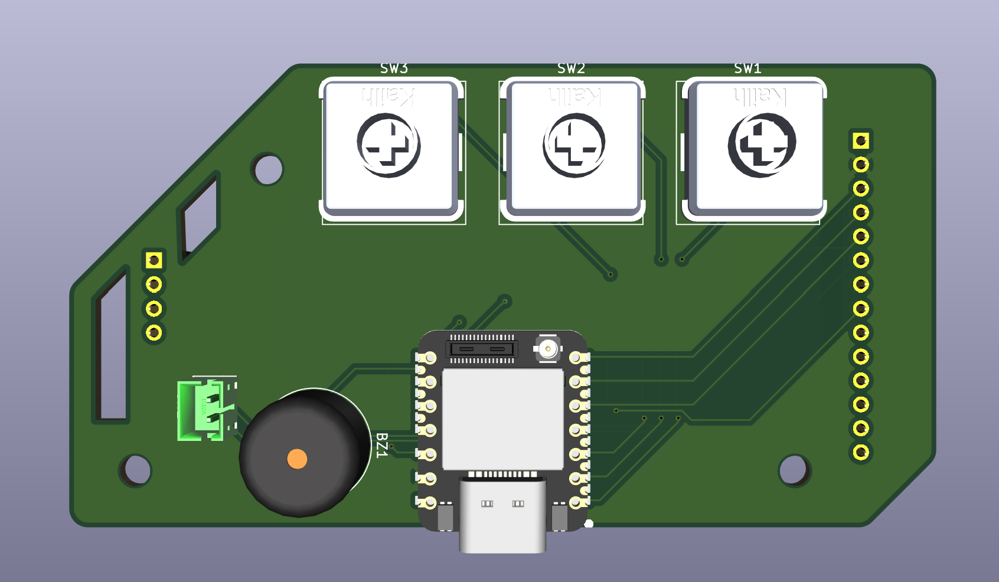

## CAD
### Design completed in Onshape

[Document Link](https://cvilleschools.onshape.com/documents/9dc3dff3a2d00cce4e52e484/w/d224b5bf15cdee65343ba0da/e/0274f1c24004c26469ea7ce8?renderMode=0&uiState=6aefdacb49cd08c4fdbf94c6)

Isometric:
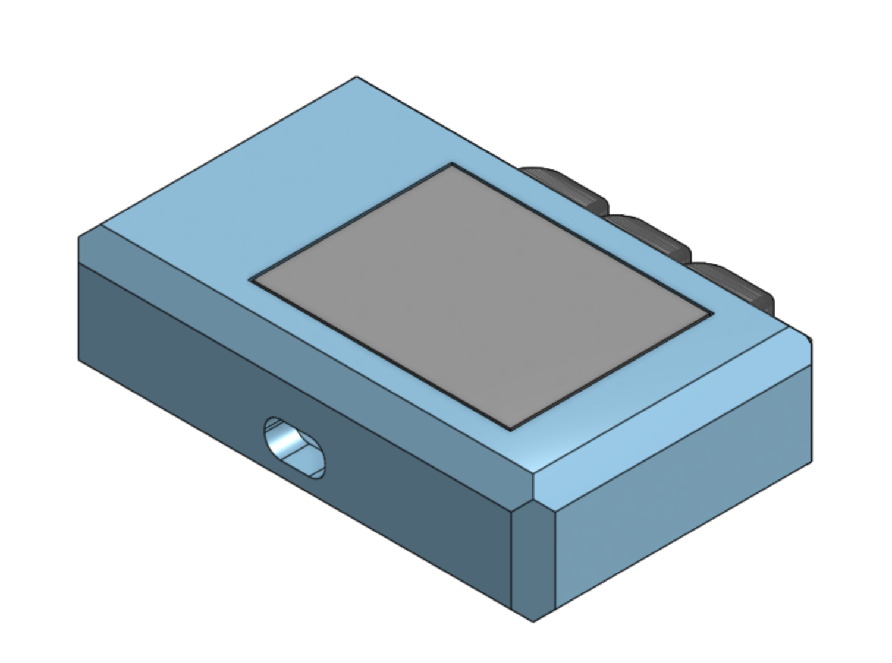

Front:
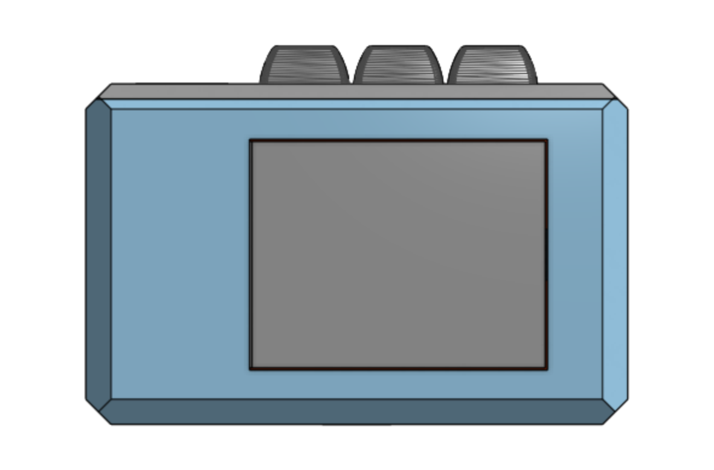

Back:
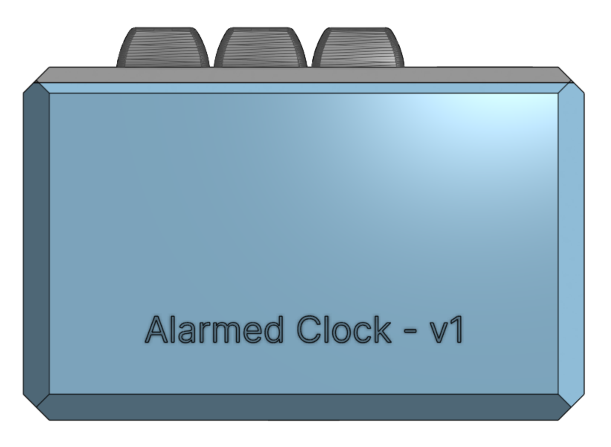

Top:
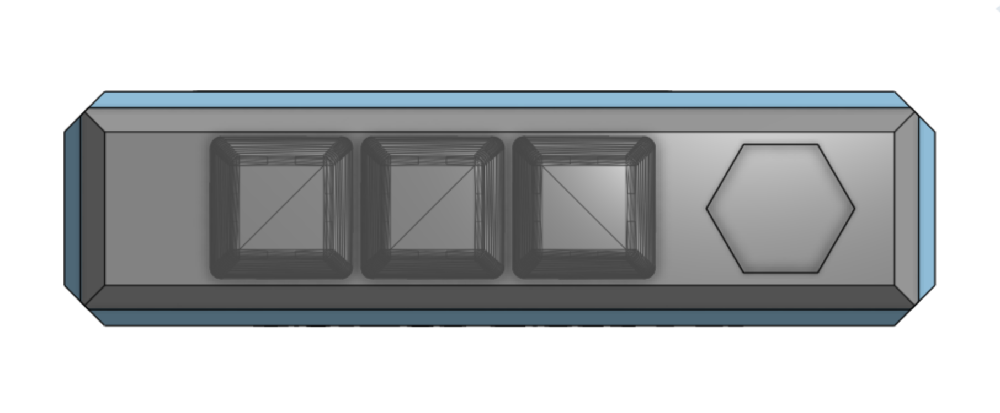

Bottom (port):
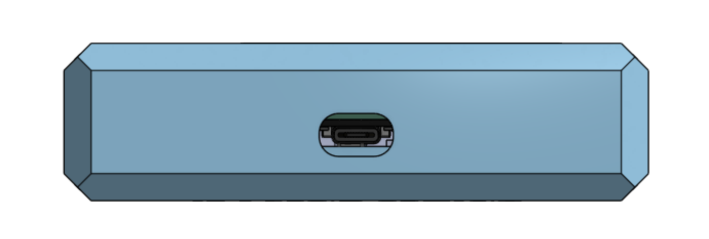

Sides:
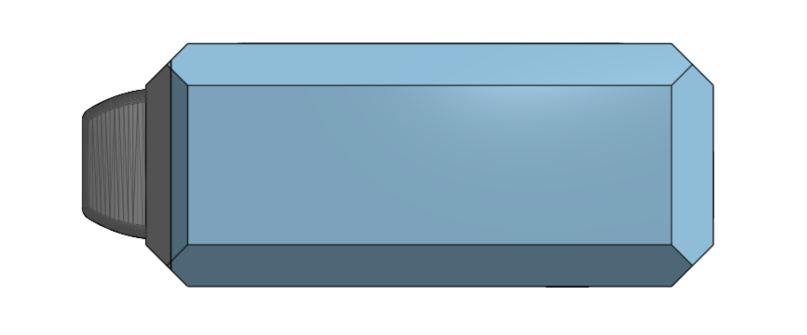 

## PCB Order 
Via JLCPCB:
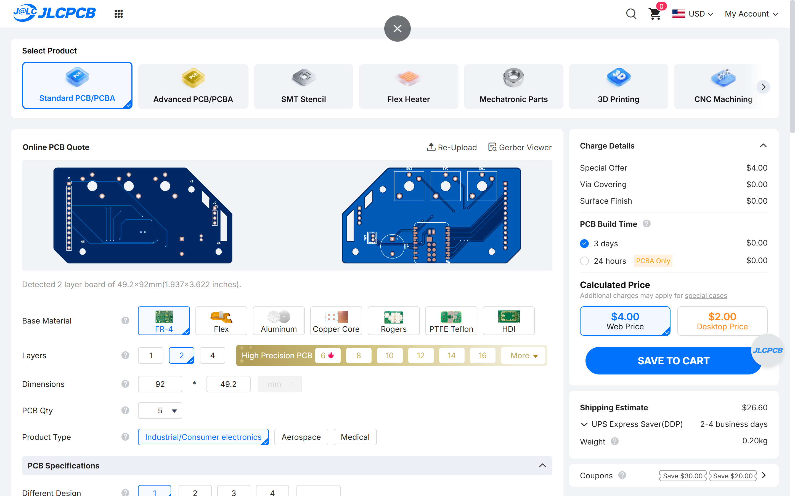

### BOM
|Quantity|Description                      |Price                                               |Purpose                                                                               |Manufacturer        |Supplier                              |Link                                                                                                                                                                                                                                                                                                                                                                                                                                                                                                                                                                                                                     |FIELD8|
|--------|---------------------------------|----------------------------------------------------|--------------------------------------------------------------------------------------|--------------------|--------------------------------------|-------------------------------------------------------------------------------------------------------------------------------------------------------------------------------------------------------------------------------------------------------------------------------------------------------------------------------------------------------------------------------------------------------------------------------------------------------------------------------------------------------------------------------------------------------------------------------------------------------------------------|------|
|1       | XIAO ESP32S3 Plus               | $7.90                                              | MCU to communicate to WiFi and run code                                              | Seeed Studio       | Seeed Studio                         | https://www.seeedstudio.com/Seeed-Studio-XIAO-ESP32S3-Plus-p-6361.html?srsltid=AYCX9vJxZSAwjrUI7pF0ljs7JlnbIa4n6NOk-60a7d-rv-yQvqUlJJ96                                                                                                                                                                                                                                                                                                                                                                                                                                                                                 |      |
|3       | Kailh Choc 2 Keyswitches        | $0.6 per (3 needed)                                | Button input                                                                         | Kailh              | Amazon (Currently Owned)             | https://www.amazon.com/KAILH-Profile-Mechanical-Keyboard-Keystem/dp/B0B463YXGQ/ref=sr_1_1_sspa?dib=eyJ2IjoiMSJ9.wxFdw1Pe7LOSd966UxVZUcDKomHLuleLIcXTQ4C0H2OYvQuT6RBjL9nNYi-8R9i4hKspNWTHWkpp5UTh7RcvgwtB2-XZpqW57wmhBzVCubamU9ifGvLU4fsc5gY4zMSOE4ZC4DMauPttKu-EcYQpunBiSKjQ7Bb7eE-JyNmWT34IKr3XreAA5Uih6Pkxwsu5_BBwKSwNySoJsfGGG-lP7ZRqvkA1rQauyjz1yVmmQBw.MvRmVcVKc9_-DKk9rJdhjHAi8Og3_gsiFY7_3GpMbQ0&dib_tag=se&keywords=kailh+choc+v2&qid=1794098954&sr=8-1-spons&sp_csd=d2lkZ2V0TmFtZT1zcF9hdGY&psc=1                                                                                                                          |      |
|3       | Cherry MX Style Blank Keycaps   | $10 per 10 units (3 needed)                        | Button clicky comfort                                                                | PATIKIL            | Amazon (Currently Owned)             | https://www.amazon.com/PATIKIL-Universal-Replacement-Accessories-Mechanical/dp/B0B5KZQ9X9/ref=sr_1_7_sspa?crid=12ATOS6KH7DQS&dib=eyJ2IjoiMSJ9.-PEZO3lmrldqZH0to2R2HRwN5BKRn86UWDtIm__w3eBpasSO6ZcCaM8QUq_QC9RgCpf5S-4EZqDYFlEzHrvcDUFbGRBe5v_g-2uizBUqArkQR8r0fBgW3fjjAHnhHtVhcrmu-O6b1ETLkijcrdWsNscyHGEe1Wfe2qANjGtk2DE58KXFpQiHFqz2rpJbc1Yo6SbPw8HZisYYzNHv0vWksAsGGalZiP4I_vSb9mQW3ls.IQFXB0KRTVGAZzOyLXqZZXrNk55Y8BOvogiIjWzgNds&dib_tag=se&keywords=Cherry%2BMX%2BKeycaps%2Bblank%2B10pcs&qid=1788231734&sprefix=cherry%2Bmx%2Bkeycaps%2Bblank%2B10pcs%2Caps%2C93&sr=8-7-spons&sp_csd=d2lkZ2V0TmFtZT1zcF9tdGY&th=1|      |
|1       | Shillehtek 2.8" TFT Display     | $10.99                                             | Displaying information; SD card data storage                                         | Shillehtek         | Shillehtek                           | https://shillehtek.com/products/2-8-spi-tft-lcd-touch-screen-module-240x320-ili9341-for-arduino?srsltid=AYCX9vIh7LBUbMqbMsmKVdWfoJGANU9fe-zuG7ylrXbS2I1idACA-6uZ                                                                                                                                                                                                                                                                                                                                                                                                                                                        |      |
|1       |  1x4 Male Header Pin            | $0.36                                              | Holding up other side of screen (the display comes with one) (and SD card connection)| Digikey            | Hack Club (BLARE kit)                | https://www.digikey.com/en/products/detail/amphenol-icc-fci-/77311-118-04LF/1523799?gclsrc=aw.ds&gad_source=1&gad_campaignid=20504594076&gbraid=0AAAAADrbLlhrE__MGVZ1djlg2N_s4QS_C&gclid=CjwKCAiAtbvXBhB_EiwAjwv9Jqfx1JAz7Fl8_0-0TrCNKfjLfloNJBBTnrZEMnRciTCU1dFRIJ7HDRoCcR0QAvD_BwE                                                                                                                                                                                                                                                                                                                                    |      |
|1       | Passive Piezoelectric Buzzer    |  $1.5                                              | Playing alarm and "music"                                                            | Adafruit Industries| Hack Club (BLARE kit)                | https://www.adafruit.com/product/160?srsltid=AYCX9vJh_QuNLozkjfWoHRwfDYuFgT-AlzdaMG031J6YqCmVwYJ4LiPj                                                                                                                                                                                                                                                                                                                                                                                                                                                                                                                   |      |
|1       |  JST 2-pin header               | $0.72 for 20                                       | Connecting battery cable                                                             | JST                | LCSC.com                             | https://www.lcsc.com/product-detail/C131337.html?s_z=n_q_C131337&globalKeyword=C131337                                                                                                                                                                                                                                                                                                                                                                                                                                                                                                                                  |      |
|1       | 3.7v LiPo Battery w/ Short Cable| $6.95                                              | Powering circuit when not connected over USB-C                                       | Adafruit Industries| Adafruit Industries                  | https://www.adafruit.com/product/4236                                                                                                                                                                                                                                                                                                                                                                                                                                                                                                                                                                                   |      |
|1       | PETG Filament for Case          | ~$1.5 (~$0.03 per gram for ~43 grams at 50% infill)| Protecting circuit and PCB                                                           | Bambu              | Bambu A1 Mini or P1S (free access to)| https://us.store.bambulab.com/products/petg-basic?id=738167451007287326&skr=yes&srsltid=AYCX9vKs56FvN0TbogePtkfMKkGFU-8XHuPbflE_q1Ne9i5W7lo3gTJMRZw                                                                                                                                                                                                                                                                                                                                                                                                                                                                     |      |

## Credits
This project was created as for Hack Club's BLARE YSWS (blare.hackclub.com) as a part of Hack Club and NASA's Stardance program which was a 6 month long program where teens built (and shipped!) technical projects and got cool stuff in return (stardance.hackclub.com)! Hack Club is a non-profit that runs really awesome programs for teenagers, if you're a teen reading this, you should give it a shot! https://www.hackclub.com